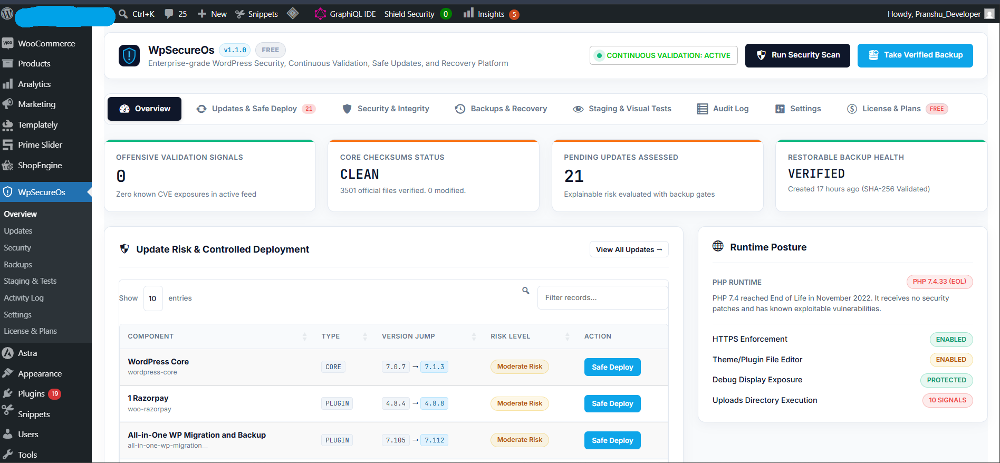

# WpSecureOs

<p align="center">
  
</p>

<p align="center">
  <strong>Enterprise-Grade WordPress Security, Continuous Validation, Safe Updates & Recovery Platform</strong>
</p>

<p align="center">
  
  
  
  
  
</p>

---

## Overview

**WpSecureOs** is an enterprise-grade security operations and safe update orchestration platform designed specifically for WordPress developers, agency engineers, and mission-critical enterprise environments.

Traditional updates rely on blind trust, often breaking production sites, failing silently, or introducing unreviewed vulnerabilities. WpSecureOs establishes an explainable, evidence-backed workflow:

$$\text{Assess} \longrightarrow \text{Back up} \longrightarrow \text{Stage} \longrightarrow \text{Test} \longrightarrow \text{Approve} \longrightarrow \text{Deploy} \longrightarrow \text{Verify} \longrightarrow \text{Recover}$$

---

## Telemetry Dashboard Preview



---

## Screenshots & Interface Tour

| # | Preview & Screenshot | Description |
|---|----------------------|-------------|
| **1** | [Overview Dashboard](assets/images/screenshot-1.png) | Unified telemetry displaying real-time security posture, core checksum verification status, pending updates risk signals, and runtime health. |
| **2** | [License & Subscription Telemetry](assets/images/screenshot-2.png) | Cryptographic license activation, site quota management, and plan tiers (Free, Pro, Agency, Business). |
| **3** | [Security & File Integrity](assets/images/screenshot-3.png) | Official WordPress core checksums validation against api.wordpress.org signatures and uploads directory executable script detection. |
| **4** | [Platform Settings & Integrations](assets/images/screenshot-4.png) | Threat intelligence feed configuration, staging visual regression tolerance thresholds, and fleet central control plane pairing. |
| **5** | [Staging Sandbox & Automated Smoke Tests](assets/images/screenshot-5.png) | Isolated test environment posture (email suppression, indexing prevention, mock checkout) and automated REST API and WooCommerce checkout tests. |
| **6** | [Explainable Update Risk Assessment](assets/images/screenshot-6.png) | Multi-factor risk engine showing Security Urgency, Deployment Confidence, granular risk factors, and guided safe deployment workflows. |

---

## Core Capabilities

### 1. Explainable Update Risk Engine
- Replaces opaque percentages with distinct **Security Urgency** (*Routine*, *Important*, *Critical*) and **Deployment Confidence** (*Low*, *Moderate*, *High*, *Unknown*).
- Formulates risk factors from verifiable signals: vulnerability intelligence databases, semantic version jump severity (Major/Minor/Patch), database migration flags, WooCommerce checkout path involvement, and backup status.

### 2. Continuous Security Validation & File Integrity
- **Core File Checksums:** Real-time cryptographic validation against official WordPress MD5 checksums published by `api.wordpress.org`.
- **Uploads Execution Guard:** Passive inspection for executable scripts (`.php`, `.phtml`, `.cgi`) inside public upload directories without automated destructive deletions.
- **Hardening Checks:** Theme/Plugin editor status, HTTPS enforcement, and debug display leak diagnostics.

### 3. Staging Sandbox & Automated Smoke Tests
- Sandbox isolation: automated interception of `wp_mail`, injection of `X-Robots-Tag: noindex`, and forced sandboxing of payment gateways.
- Visual regression checks comparing baseline DOM snapshots with configurable difference thresholds.
- Technical smoke tests verifying core REST API endpoints (`/wp-json/wp/v2/`), scanning error logs for unhandled fatal errors, and executing mock checkout transactions.

### 4. Verified Backups & Point-in-Time Recovery
- Dual validation: tests zip archive readability and verifies SHA-256 integrity checksums prior to approving an update.
- Actionable disaster recovery runbooks documenting exact restore steps in the event of hardware or host failures.

### 5. Dual Authorization & Cryptographic Invariants
- Dual security gate: all administrative tasks require explicit WordPress capabilities (7 custom roles) and CSRF nonce verification.
- Tamper-evident licensing using Ed25519 & HMAC-SHA256 signatures with a 7-day offline grace period.
- **Security Invariant:** Emergency recovery runbooks and file integrity scans remain permanently active even if a license expires.

---

## WordPress.org Plugin Repository Structure

This repository contains the complete structure required by the [WordPress.org Plugin Guidelines](https://developer.wordpress.org/plugins/wordpress-org/):

```
wpsecureos/
├── assets/                     # Plugin assets (CSS, JS, images, vendor)
│   ├── css/
│   ├── js/
│   ├── vendor/
│   └── images/
│       ├── banner-772x250.png   # WP.org directory standard banner
│       ├── banner-1544x500.png  # WP.org directory retina banner
│       ├── icon-128x128.png     # WP.org directory icon 128px
│       ├── icon-256x256.png     # WP.org directory icon 256px
│       ├── icon.svg             # WP.org directory vector icon
│       ├── logo.svg             # Brand vector logo
│       ├── screenshot-1.png     # Screenshot 1: Overview Dashboard
│       ├── screenshot-2.png     # Screenshot 2: License Telemetry
│       ├── screenshot-3.png     # Screenshot 3: Security & Checksums
│       ├── screenshot-4.png     # Screenshot 4: Platform Settings
│       ├── screenshot-5.png     # Screenshot 5: Staging Smoke Tests
│       └── screenshot-6.png     # Screenshot 6: Risk Assessment
├── includes/                   # Core PHP architecture & classes
├── languages/                  # Translation POT/PO/MO files
├── templates/                  # High-contrast UI view templates
├── composer.json               # Package definitions
├── readme.txt                  # Official WordPress.org validated readme
├── uninstall.php               # Safe uninstallation lifecycle
└── wpsecureos.php              # Main bootstrap & plugin header definitions
```

---

## Submitting to WordPress.org

1. **Upload Form:** Navigate to [WordPress.org Plugin Submission](https://wordpress.org/plugins/developers/add/).
2. **Zip Package:** Upload the generated `wpsecureos.zip` (created via `build.ps1` or `build.php`).
3. **SVN Repository Setup:** Once approved, commit the `wporg-assets/` directory to the root `/assets/` folder of your WordPress.org SVN repository, and the plugin code to `/trunk/` and `/tags/1.1.0/`.

---

## License

WpSecureOs is open-source software licensed under the [GNU General Public License v2.0 or later](https://www.gnu.org/licenses/gpl-2.0.html).
